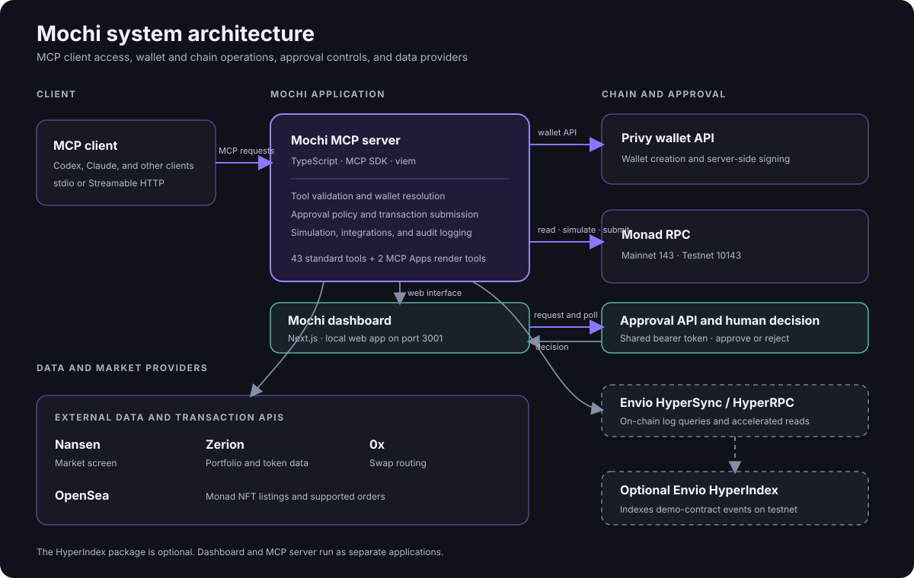
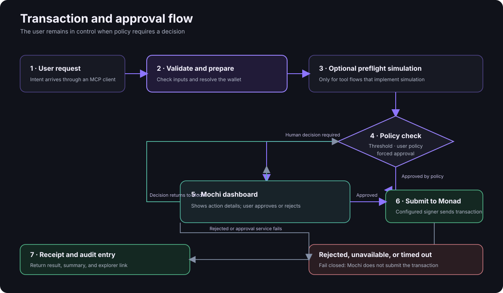

# Mochi — Pocket money, soft and sweet (on Monad)

**A user-controlled wallet and on-chain toolkit for AI agents.** Mochi connects MCP-compatible clients to Monad through a broad set of read and write tools, an embedded dashboard, and explicit transaction approval rules.

Mochi is built around a practical delegation boundary: the agent can gather information and prepare supported actions; the user retains control over transactions that require approval. Wallet signing runs outside the model context through Privy or a local development signer.

> **Network and contract safety:** the repository contains Monad mainnet integrations and Monad testnet demo contracts. The sample NFT market, AMM, auction house, and lending pool are experimental contracts and have not been audited. Do not use them with valuable assets. Review every transaction and only use mainnet features with accounts, keys, and limits you intentionally configured.

## Contents

- [What Mochi includes](#what-mochi-includes)
- [Architecture](#architecture)
- [Transaction and approval workflow](#transaction-and-approval-workflow)
- [MCP capabilities](#mcp-capabilities)
- [Setup](#setup)
- [Connect an MCP client](#connect-an-mcp-client)
- [Run the dashboard](#run-the-dashboard)
- [Network integrations](#network-integrations)
- [Example conversations](#example-conversations)
- [Environment variables](#environment-variables)
- [Local state and security](#local-state-and-security)
- [Development commands](#development-commands)
- [Repository map](#repository-map)
- [Known limits](#known-limits)
- [License](#license)

## What Mochi includes

- **MCP server:** 43 standard tools for wallets, transactions, contracts, NFTs, DeFi, lending, contacts, settings, and chain data, plus two MCP Apps render tools for Mochi Market and Mochi Auctions.
- **Wallet support:** Privy-managed Ethereum wallets, a local development signer, and read-only wallet records.
- **Dashboard:** password sign-in, wallet and network views, transaction activity, NFT market and auction pages, and a human approval queue.
- **Monad integrations:** Zerion portfolio and pricing, 0x Swap API, OpenSea Monad listings and supported purchases, and a Nansen/Envio market brief.
- **Demo contracts:** Solidity examples for fungible tokens, a small AMM, fixed-price NFT sales, auctions, offers and a lending pool.
- **Optional indexer:** Envio HyperIndex event handlers for the demo contracts on Monad testnet.

The MCP server also exposes **one agent context prompt**, **four network/wallet/documentation resources**, and **two UI resources** used by the embedded marketplace and auction widgets.

## Architecture



The MCP server owns tool validation, wallet resolution, integration logic, policy checks, and transaction submission. The dashboard is a separate local web application. The optional HyperIndex package is a separate event indexer; the core MCP server does not require it to start.

### Request flow at a glance



Simulation is implemented for selected flows; it is **not** a universal precondition for every state-changing tool. See [Known limits](#known-limits).

## Transaction and approval workflow

1. The MCP client calls a tool. Zod schemas validate structured inputs such as addresses, amounts, ABI fragments, and slippage.
2. Mochi resolves the wallet associated with `userId` (or the default wallet) and prepares the requested operation.
3. For flows with simulation support, Mochi simulates the intended call before proceeding.
4. The approval gate applies the per-user automatic policy when enabled and applicable. Actions that require a human are sent to the dashboard.
5. The dashboard displays the request details and accepts an explicit approve/reject decision.
6. The MCP server submits approved operations through Privy or the local signer, waits for the chain receipt where implemented, and records the result.

By default, the per-user auto-approval switch is off. The main `SPENDING_LIMIT_WEI` defaults to **1 MON**; value at or above that threshold goes through the approval flow unless an eligible user policy approves it. Tools can force approval independently of value. Forced approvals cannot be bypassed by the general automatic policy; this includes ERC-20 sends, contract deployment, OpenSea buys, and mainnet 0x swaps.

When an approval is required, the dashboard must be running and reachable. A rejected request, unavailable approval endpoint, or timeout fails closed for that gated action. The dashboard and MCP server must share the same `APPROVAL_API_TOKEN`.

## MCP capabilities

All tools return JSON text with an `ok` result and, where appropriate, a concise summary. Read-only tools do not submit transactions. Transaction tools generally return a transaction hash and explorer URL after successful submission.

### Wallet and portfolio

| Tool | Capability |
|---|---|
| `wallet_initialize` | Create or load a wallet record for a `userId`. |
| `wallet_get_address` | Return the current wallet address and explorer link. |
| `wallet_get_balance` | Read MON and supported token balances. |
| `wallet_import` | Associate an existing address/wallet identifier with a `userId`. |
| `wallet_portfolio` | Read a Zerion portfolio/net-worth view for a wallet. |

### Transactions and contracts

| Tool | Capability |
|---|---|
| `transaction_send_mon` | Send MON to an address or saved contact; uses the spending/approval policy. |
| `transaction_send_token` | Send an ERC-20 token; requires the human approval flow. |
| `transaction_estimate_gas` | Estimate gas units, gas price, and total cost in MON. |
| `transaction_simulate` | Simulate a call without broadcasting; return revert, fee, and affordability information. |
| `transaction_get_status` | Look up a transaction’s pending/confirmed/failed status and receipt details. |
| `contract_read` | Call a supplied view/pure contract function. |
| `contract_write` | Call a supplied state-changing contract function; value-bearing or explicitly flagged calls use approval rules. |
| `contract_deploy` | Deploy supplied bytecode and ABI; always requires explicit human approval. |

### NFTs and markets

| Tool | Capability |
|---|---|
| `nft_research_collections` | Discover collection and marketplace research data available through configured sources. |
| `nft_get_user_collection` | Read an address’s ERC-721 collection holdings. |
| `nft_buy` | Buy through the configured demo fixed-price NFT market. |
| `nft_bid` | Place a bid in the configured English auction contract. |
| `nft_settle_auction` | Settle an ended auction through the demo auction contract. |
| `nft_launch_collection` | Deploy and initialize a collection using the configured deployment flow. |
| `nft_offer` | Place a MON-backed offer through the demo market. |
| `nft_accept_offer` | Accept an offer as the NFT seller. |
| `nft_cancel_offer` | Cancel an offer and reclaim its escrow where the contract permits. |
| `nft_cancel_listing` | Cancel a listing in the configured market. |
| `nft_opensea_listings` | Read active Monad listings for an OpenSea collection. |
| `nft_opensea_buy` | Purchase a supported OpenSea Monad listing; validates the active order and price ceiling and requires human approval. |
| `render_marketplace` | Render the Mochi Market MCP App with listing data. |
| `render_auctions` | Render the Mochi Auctions MCP App with auction data. |

### DeFi, lending, and market data

| Tool | Capability |
|---|---|
| `defi_monad_market_brief` | Read Nansen’s 24-hour Monad token screen and, when configured, enrich it with recent ERC-20 Transfer counts from Envio HyperSync. Read-only. |
| `defi_get_token_price` | Resolve a price from the configured DEX quote path or Zerion where available. |
| `defi_swap_tokens` | On mainnet, prepare/execute a supported 0x exact-input ERC-20 swap with mandatory approval and safety checks; on testnet, use the configured demo router. |
| `defi_faucet_mint` | Mint demo TTA/TTB tokens on testnet only. |
| `lending_positions` | Read pool and loan position information from the configured lending contract. |
| `lending_deposit` | Deposit MON into the configured NFT lending pool. |
| `lending_withdraw` | Redeem pool shares for MON where liquidity permits. |
| `lending_borrow` | Borrow MON against eligible NFT collateral under the demo pool’s rules. |
| `lending_repay` | Repay a loan and release collateral when the contract’s repayment conditions are met. |

The lending tools require a configured pool address. The included lending contract is a demo implementation and is unaudited; do not treat it as a production lending protocol.

### Contacts, settings, and chain data

| Tool | Capability |
|---|---|
| `contacts_save` | Save a human-readable recipient name and EVM address. |
| `contacts_list` | List saved contacts for a `userId`. |
| `contacts_remove` | Remove a saved contact. |
| `settings_set_auto_approve` | Enable/disable the user’s capped automatic approval policy and optional action scope. |
| `settings_get_policy` | Read the active automatic approval policy. |
| `chain_get_network_stats` | Read current block/network statistics from the configured chain. |
| `chain_get_block` | Read a block by number or latest. |
| `chain_get_gas_price` | Read gas price and a simple transfer-cost estimate. |
| `chain_get_logs` | Query contract event logs using configured Envio/RPC providers. |

## Setup

### Requirements

- Node.js **20 or newer**
- pnpm **10** (the repository pins `pnpm@10.0.0`)
- For Solidity compilation: [Foundry](https://book.getfoundry.sh/)
- For the optional local HyperIndex development stack: Node.js 22+, Docker Desktop, and WSL on Windows

### Install and configure

```bash
git clone https://github.com/dinitheth/Mochi.git
cd Mochi
pnpm install
```

Copy `.env.example` to `.env` in the repository root. The MCP server loads that file as a fallback even when launched from another working directory.

```bash
cp .env.example .env
```

Edit the values for the features you intend to use. To start safely, keep `MONAD_NETWORK=testnet`, use the testnet RPC, and use a dedicated demo wallet. See [Environment variables](#environment-variables).

Build the MCP server and dashboard:

```bash
pnpm --filter @monad-mcp/mcp-server build
pnpm --filter @monad-mcp/dashboard build
```

The testnet deployment manifests for demo contracts are in `packages/contracts/deployments/`. These addresses are for Monad testnet only.

## Connect an MCP client

### Codex

Add a local server entry to Codex’s MCP configuration (`~/.codex/config.toml`). Replace the path with the absolute path to your clone:

```toml
[mcp_servers.mochi]
command = 'node'
args = ['<ABSOLUTE_PATH_TO_MOCHI>/packages/mcp-server/dist/index.js']
```

Build the server first, then restart or reconnect the Mochi server in Codex. The server loads its configuration from the repository-root `.env`.

### Claude Desktop

Build the server, then add a server entry to Claude Desktop’s `claude_desktop_config.json`:

```json
{
  "mcpServers": {
    "mochi": {
      "command": "node",
      "args": ["<ABSOLUTE_PATH_TO_MOCHI>/packages/mcp-server/dist/index.js"]
    }
  }
}
```

Replace the placeholder with an absolute path using JSON path separators appropriate to your operating system. Restart Claude Desktop and confirm Mochi’s tools appear.

### Other MCP clients

Mochi supports the MCP **stdio** transport by default. Clients that support Streamable HTTP can connect to the optional HTTP transport described below. The server identity remains `monad-mcp` for compatibility; “Mochi” is the product-facing name.

## Run the dashboard

The dashboard runs separately from the MCP server. Set its environment values in `packages/dashboard/.env.local` (do not commit this file):

```dotenv
DASHBOARD_PASSWORD=replace-with-a-strong-password
DASHBOARD_SESSION_SECRET=replace-with-a-long-random-secret
APPROVAL_API_TOKEN=use-the-same-long-random-token-as-the-MCP-server
MONAD_NETWORK=testnet
MONAD_RPC_URL=https://testnet-rpc.monad.xyz
```

Run the dashboard:

```bash
pnpm --filter @monad-mcp/dashboard dev
```

Open [http://localhost:3001](http://localhost:3001). The dashboard includes a wallet/network overview, approval queue and decision history, transaction activity, Mochi Markets, and Auctions. Approval and account views require dashboard sign-in; some chain-data views use public RPC reads.

The dashboard’s API routes include `/api/auth/login`, `/api/approvals`, `/api/approvals/:id`, `/api/approvals/:id/respond`, `/api/activity`, `/api/wallet`, `/api/settings`, `/api/network`, `/api/listings`, and `/api/auctions`.

### Optional Streamable HTTP transport

Run the MCP server over HTTP:

```bash
MCP_TRANSPORT=http pnpm --filter @monad-mcp/mcp-server dev
```

Or start the built server with `MCP_TRANSPORT=http` (the server also accepts `--http`). By default, it listens on port **3002**. `GET /health` returns a health response and MCP requests use `POST /mcp`.

The HTTP transport does not add application-level authentication in this codebase. Keep it on a trusted local network or place it behind an authenticated, TLS-terminating gateway before exposing it remotely.

## Network integrations

| Integration | Mochi capability | Network / configuration |
|---|---|---|
| Monad RPC | Balance, block, gas, logs, reads, simulations, and transaction receipts. | Mainnet: chain ID 143. Testnet: chain ID 10143. |
| Privy | Managed wallet creation and server-side transaction signing. | `PRIVY_APP_ID`, `PRIVY_APP_SECRET`. |
| Zerion | Wallet portfolio and token-price data where supported by the account/API. | `ZERION_API_KEY`. |
| 0x Swap API v2 | Mainnet exact-input ERC-20 swap route and transaction data. Not a direct Uniswap/Kuru adapter. | `OX_API_KEY`; mandatory human approval on mainnet. |
| OpenSea API v2 | Read Monad collection listings and buy supported native-MON orders. | `OPENSEA_API_KEY`; buy is restricted to the adapter’s verified flow and mandatory approval. |
| Nansen Token Screener | 24-hour token market screen for Monad. | `NANSEN_API_KEY`. |
| Envio HyperSync / HyperRPC | Event-log scans and selected accelerated reads. The market brief uses HyperSync Transfer logs; chain tools may fall back among configured sources. | `HYPERSYNC_TOKEN`, `HYPERSYNC_URL`, optional `HYPER_RPC_URL`. |
| Envio HyperIndex | Optional indexer for Mochi’s demo contracts on Monad testnet. | Separate package in `packages/indexer`; not required by the MCP server. |

**Integration scope:** these are the direct integrations represented in code. Other Monad ecosystem protocols such as Kuru, 1inch, Aave, Morpho, or liquid-staking platforms are not direct Mochi adapters here. A route returned by an aggregator does not mean Mochi implements that underlying protocol’s native API or positions.

### Optional Envio HyperIndex package

The indexer is excluded from the root pnpm workspace. It indexes demo AMM, marketplace, auction, NFT, and token events on testnet. See [`packages/indexer/README.md`](packages/indexer/README.md) and `packages/indexer/config.yaml` for the configured contracts and start block.

```bash
cd packages/indexer
pnpm install
pnpm codegen
pnpm dev
```

Local development uses Envio’s API token from `packages/indexer/.env` and requires Docker Desktop/WSL where applicable. The indexer package is optional; the dashboard and MCP server can run without its local GraphQL service.

## Example conversations

These are illustrative client conversations. The agent should use the actual tool result and current network rather than inventing balances, prices, contract addresses, or transaction hashes.

### Create or load a wallet

> **You:** Use Mochi to set up my wallet for this demo.
>
> **Agent:** I’ll initialize the wallet record for this session.
>
> **Tool:** `wallet_initialize({ "userId": "demo" })`
>
> **Agent:** Wallet mode: Privy (or the configured local/read-only mode). Address: `<returned address>`. Network: Monad Testnet. You can check its balance with `wallet_get_balance`.

### Inspect a portfolio

> **You:** What’s in my Monad portfolio?
>
> **Agent:** I’ll read the portfolio linked to the current wallet.
>
> **Tool:** `wallet_portfolio({ "userId": "demo" })`
>
> **Agent:** Zerion returned `<actual assets and totals>` for `<actual address>`. The response identifies the provider and any unavailable data.

### Send MON with a dashboard decision

> **You:** Send 1.2 MON to Sam for the ticket.
>
> **Agent:** I found the saved contact Sam. This amount meets the default approval threshold, so I’ll request your decision before sending.
>
> **Tool:** `transaction_send_mon({ "to": "Sam", "amount": "1.2", "reason": "ticket", "userId": "demo" })`
>
> **Dashboard:** Displays the transaction request. You choose **Approve** or **Reject**.
>
> **Agent:** After approval, Mochi submits the transaction and returns the receipt and explorer link. If rejected or timed out, nothing is sent.

### Explore the Monad market brief

> **You:** What tokens are active on Monad today? Include recent on-chain transfer activity.
>
> **Agent:** I’ll fetch the 24-hour Nansen screen and check the configured Envio scan window.
>
> **Tool:** `defi_monad_market_brief({ "limit": 5 })`
>
> **Agent:** Shows the returned metrics, retrieval timestamp, per-token transfer-event counts when available, the scanned block range, and any source limitations. This is market data, not a trade recommendation.

### Prepare a supported mainnet swap

> **You:** Swap `<amount>` of `<token address>` for `<token address>` on Monad mainnet. Use at most 0.5% slippage.
>
> **Agent:** I’ll request a 0x quote and show the route, expected output, minimum output, and approval details before executing.
>
> **Tool:** `defi_swap_tokens({ "tokenIn": "<address>", "tokenOut": "<address>", "amountIn": "<amount>", "slippageTolerance": 0.5 })`
>
> **Agent:** Mochi requires human approval on this mainnet swap. After approval, it fetches a fresh quote and checks the approved minimum before simulating and submitting the supported transaction flow.

### Find and buy an OpenSea Monad listing

> **You:** Find listings for `<collection slug>` on OpenSea’s Monad marketplace.
>
> **Agent:** Calls `nft_opensea_listings` and summarizes the live results returned by OpenSea.
>
> **You:** Buy `<order hash>` for no more than 2 MON.
>
> **Agent:** Calls `nft_opensea_buy` with the order and price ceiling. Mochi revalidates the order, requests human approval, then rechecks and simulates the supported transaction before submission.

### Read before writing to a contract

> **You:** Check `totalSupply()` on `<contract address>`.
>
> **Agent:** Calls `contract_read` with the ABI fragment and returns the value.
>
> **You:** Call `setLimit(10)` on the same contract.
>
> **Agent:** Explains the exact target and arguments, then calls `contract_write`. Approval behavior depends on the call’s MON value and `requireApproval` setting. Review the target and function before approving.

## Environment variables

The server configuration is parsed in `packages/mcp-server/src/config/env.ts`. Put server variables in the repository-root `.env`. Put dashboard-only values in `packages/dashboard/.env.local`. Never commit either file.

| Variable | Purpose | Default / note |
|---|---|---|
| `MONAD_NETWORK` | Select `mainnet` or `testnet`. | `testnet`. |
| `MONAD_RPC_URL` | Monad testnet RPC URL. | `https://testnet-rpc.monad.xyz`. |
| `MONAD_MAINNET_RPC_URL` | Monad mainnet RPC URL. | `https://rpc.monad.xyz`. |
| `PRIVY_APP_ID`, `PRIVY_APP_SECRET` | Privy wallet creation and managed signing. | Optional for read-only/local development; required for Privy mode. |
| `DEV_PRIVATE_KEY` | Local development signing key. | Optional; keep in a private local env file only. |
| `AGENT_ADDRESS` | Preconfigured address for read-only setup. | Optional. |
| `SPENDING_LIMIT_WEI` | Default MON value threshold for approval gating. | `1000000000000000000` (1 MON). |
| `APPROVAL_WEBHOOK_URL` | Dashboard approval endpoint. | `http://localhost:3001/api/approvals`. |
| `APPROVAL_API_TOKEN` | Bearer credential shared by MCP server and dashboard. | Set the same strong random value in both. |
| `APPROVAL_POLL_TIMEOUT_MS` | Maximum wait for an approval decision. | `300000` (5 minutes). |
| `MCP_TRANSPORT`, `MCP_HTTP_PORT` | Select stdio/HTTP and HTTP port. | `stdio`, `3002`. |
| `NANSEN_API_KEY` | Nansen market and collection research. | Optional. |
| `ZERION_API_KEY` | Zerion portfolio and token data. | Optional. |
| `OX_API_KEY` | 0x Swap API. | Optional; mainnet swap integration. |
| `OPENSEA_API_KEY` | OpenSea API v2. | Optional; listing discovery and supported purchase flow. |
| `HYPERSYNC_TOKEN`, `HYPERSYNC_URL` | Envio HyperSync data queries. | Token optional; URL defaults to Monad testnet endpoint. Use `https://monad.hypersync.xyz` for Monad mainnet. |
| `HYPER_RPC_URL` | Optional Envio HyperRPC endpoint. | Empty by default. |
| `MICROSWAP_POOL_ADDRESS` | Override the testnet demo AMM pool. | Optional. |
| `MOCK_NFT_ADDRESS`, `MICROMARKET_ADDRESS`, `AUCTION_HOUSE_ADDRESS`, `LENDING_POOL_ADDRESS` | Configure demo contract addresses where supported. | Use verified addresses for the selected network; sample deployments are testnet only. |
| `DASHBOARD_PASSWORD` | Password checked at dashboard sign-in. | Set in `packages/dashboard/.env.local`. |
| `DASHBOARD_SESSION_SECRET` | Signs dashboard session cookies. | Set a long random value in `packages/dashboard/.env.local`. |

Generate unique random values for dashboard secrets and approval credentials. Do not copy example placeholders into a deployed environment.

## Local state and security

### Wallet modes

- **Privy mode:** `PRIVY_APP_ID` and `PRIVY_APP_SECRET` allow Mochi to create/load Privy-managed wallets and submit through Privy’s wallet API. Private signing material is not returned to the model.
- **Local mode:** `DEV_PRIVATE_KEY` enables a server-side development signer. Treat this as a development-only secret; never put it in chat or source control.
- **Read-only mode:** `AGENT_ADDRESS` associates a wallet address without a configured signer. If no address is configured, the server can create an ephemeral local account record for a read-only demo.

### Files created at runtime

The server persists local state under `packages/mcp-server/`:

- `wallet-state.json` — user IDs, wallet IDs, addresses, network, and creation time.
- `contacts.json` — saved recipient names and addresses.
- `policy.json` — per-user automatic approval preferences.
- `collections.json` — locally launched collection records.
- `audit-log.jsonl` — tool intent/result history and transaction hashes; selected sensitive fields are redacted.

These files are user-specific runtime data and are excluded from Git. Back them up securely if the deployment needs persistence. Do not publish the dashboard or approval endpoint without adding appropriate network access controls.

### Approval and transaction safeguards

- Keep the per-user auto-approval switch off until you have reviewed the applicable cap and action scope.
- Forced approval actions stay gated regardless of the general policy.
- Gated actions fail closed if the approval endpoint rejects, cannot be reached, or times out.
- Mainnet 0x swaps require a supported exact-input ERC-20 route, a human approval, refreshed quote checks, simulation, and receipt validation in the implemented adapter.
- OpenSea buys are limited to the adapter’s supported Monad order flow and caller-provided price ceiling; they require approval and revalidation.
- `contract_write` accepts a caller-supplied address, ABI, function, and arguments. It is a general-purpose write interface, not a verified-protocol allowlist. Verify contract code and calldata before using it.
- Dashboard password sessions use signed HttpOnly cookies. MCP approval requests authenticate with the shared bearer token.
- The HTTP MCP listener itself has no built-in authentication in this repository. Do not expose it directly to the public internet.

## Development commands

Run from the repository root:

| Command | Purpose |
|---|---|
| `pnpm install` | Install root workspace dependencies. |
| `pnpm dev:server` | Run the MCP server in stdio development mode. |
| `pnpm dev:dashboard` | Run the dashboard at port 3001. |
| `pnpm build` | Build root workspace packages (MCP server and dashboard). |
| `pnpm build:server` | Compile the MCP server into `packages/mcp-server/dist`. |
| `pnpm build:dashboard` | Build the Next.js dashboard. |
| `pnpm typecheck` | Run available workspace TypeScript checks. |
| `pnpm lint` | Run available workspace linters. |
| `pnpm test` | Run the MCP server Vitest suite. |

Compile Solidity contracts separately:

```bash
cd packages/contracts
forge build
```

The optional Envio package is excluded from the root workspace; its local commands are documented above and in `packages/indexer/README.md`.

## Repository map

```text
Mochi/
├── packages/
│   ├── mcp-server/
│   │   └── src/
│   │       ├── apps/          # Mochi Market and Auctions MCP Apps
│   │       ├── config/        # Environment, wallet, chain, and provider clients
│   │       ├── integrations/  # Nansen, OpenSea, 0x adapters
│   │       ├── middleware/    # Approval gate, simulation, policy, audit log
│   │       ├── prompts/       # Agent operating context
│   │       ├── resources/     # Monad network and wallet resources
│   │       └── tools/         # MCP tool groups
│   ├── dashboard/
│   │   └── src/               # Next.js pages, API routes, components, helpers
│   ├── contracts/
│   │   ├── src/               # Solidity demo contracts
│   │   └── deployments/       # Public Monad testnet deployment manifests
│   └── indexer/               # Optional Envio HyperIndex demo indexer
├── .env.example               # Safe configuration template
├── claude_desktop_config.json # Claude Desktop example configuration
├── pnpm-workspace.yaml
└── README.md
```

### Main source areas

- `packages/mcp-server/src/index.ts` — constructs the MCP server, registers tools/resources/prompts, and starts stdio or HTTP transport.
- `packages/mcp-server/src/tools/` — schemas and handlers for wallet, transaction, NFT, DeFi, contract, lending, contact, settings, and chain operations.
- `packages/mcp-server/src/middleware/` — policy evaluation, human approval, transaction simulation, and audit logging.
- `packages/dashboard/src/app/api/` — dashboard routes for login, approvals, activity, wallet, network, policy, listings, and auctions.
- `packages/contracts/src/` — test/demo Solidity contracts.
- `packages/indexer/` — HyperIndex event definitions and handlers for the demo contracts.

## Known limits

- The dashboard’s local marketplace and auction pages read configured contracts directly; they are not a universal index of every Monad marketplace.
- The Envio HyperIndex configuration currently targets Monad testnet demo contracts. `defi_monad_market_brief` is a separate mainnet feature using Nansen and optional HyperSync log counts.
- The 0x adapter uses aggregator routes. It is not a direct integration with every DEX whose liquidity might appear in a route.
- Direct Kuru, 1inch, Aave, Morpho, Euler, liquid staking, and yield-vault adapters are not included.
- Some write tools do not run a generic preflight simulation. Read each tool’s behavior and verify target, amounts, and approval details before signing.
- The included AMM, NFT marketplace, auction, and lending contracts are demo-grade and unaudited.
- Third-party API plans, quotas, supported assets, and network coverage are controlled by those providers and can change.

## License

MIT. See [LICENSE](LICENSE).
